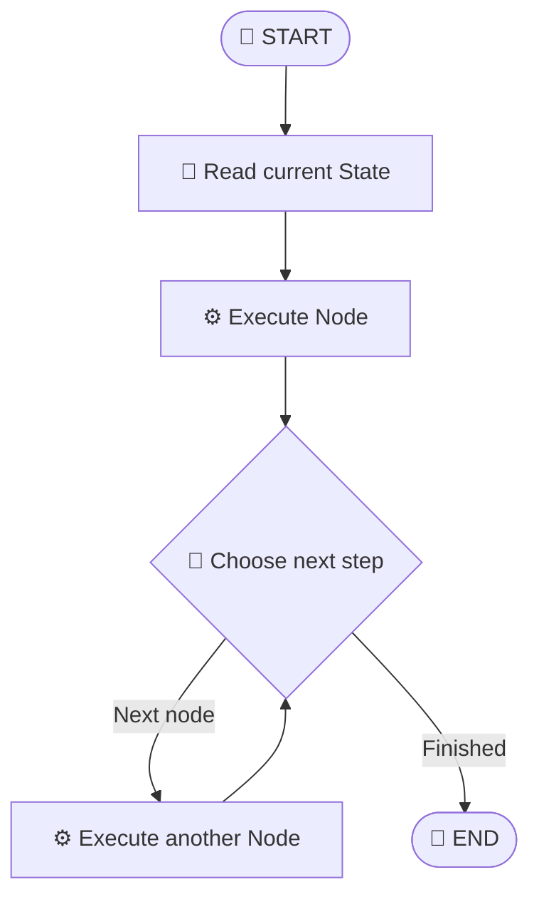
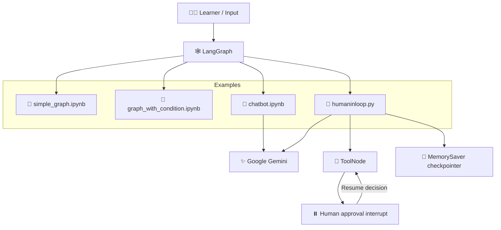
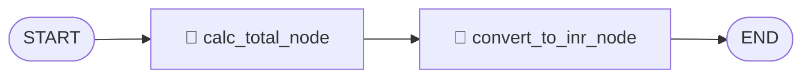
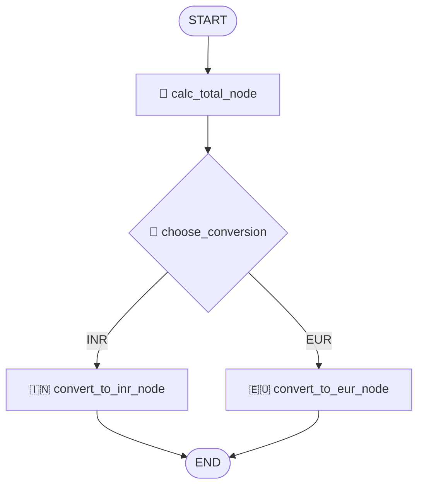
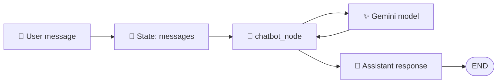
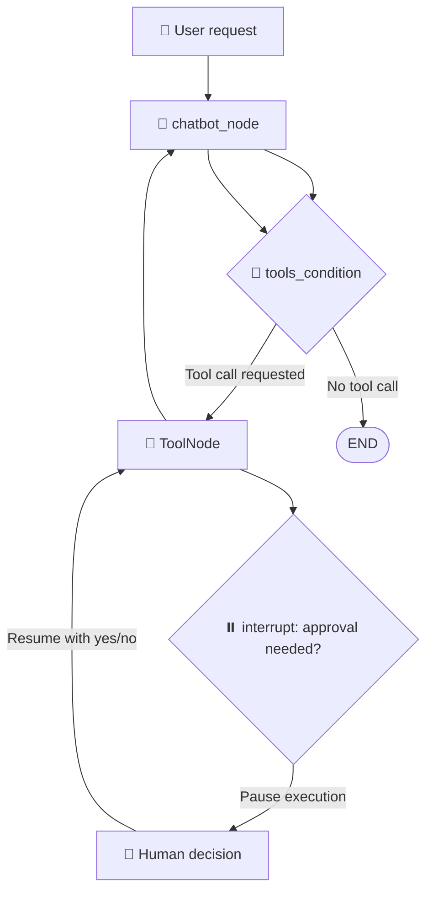

<!--
  LangGraph Learning Lab
  Repository guide generated from the checked-in source and notebooks.
  GitHub supports HTML details, tables, Mermaid diagrams, badges and emoji.
-->

<div align="center">

# 🧠 LangGraph Learning Lab

### From your first state graph to tool-calling agents with human approval

<p>
  
  
  
  
  
</p>

**A hands-on collection of small, progressively advanced examples that teach how LangGraph executes workflows, maintains state, routes between nodes, calls tools, and pauses for human decisions.**

[Repository](https://github.com/SwekcchaCornicle/langGraph) · [LangGraph Docs](https://docs.langchain.com/oss/python/langgraph/overview) · [LangChain Docs](https://docs.langchain.com/oss/python/langchain/overview)

</div>

---

## 🗺️ Start here — the learning map

| Example | What you learn | Main concepts |
|---|---|---|
| [`simple_graph.ipynb`](./simple_graph.ipynb) | Build a fixed, sequential workflow | State, nodes, edges, START, END |
| [`graph_with_condition.ipynb`](./graph_with_condition.ipynb) | Choose a path based on state | Conditional edges, routing |
| [`chatbot.ipynb`](./chatbot.ipynb) | Connect a graph to a Gemini model | Messages, LLM invocation, conversation loop |
| [`humaninloop.py`](./humaninloop.py) | Let an agent use tools and request approval | ToolNode, tool routing, checkpointing, interrupt/resume |

> 💡 **Suggested order:** run the notebooks from top to bottom, then study `humaninloop.py`. Each example introduces a building block used by the next one.

## 🎯 What is this repository?

This repository is a practical LangGraph learning lab. It demonstrates four patterns:

1. **Deterministic workflow:** run known functions in a defined order.
2. **Conditional workflow:** decide which function should run next using the current state.
3. **LLM workflow:** let a language model generate a response within a graph.
4. **Tool-using workflow with human approval:** let the model request tools, execute them, and pause before a consequential action.

It is a learning project rather than a production-ready application. The stock prices and conversion rates in the examples are illustrative constants, and the stock purchase tool does not connect to a broker.

---

## 🧩 LangGraph in plain English

Think of LangGraph as a way to build a workflow using connected steps.

- **State** is the shared notebook that carries information through the workflow.
- **Node** is one task or function.
- **Edge** tells the workflow where to go next.
- **Conditional edge** chooses the next node based on a decision.
- **START** is the entry point.
- **END** is the finish point.
- **Checkpointer** saves graph state so execution can continue later.
- **Interrupt** pauses execution and asks an external human or application for a decision.

### The mental model



The important idea: **you describe the workflow as a graph; LangGraph runs it and moves state between nodes.**

## 🏗️ Repository architecture



### Folder and file guide

| Path | Purpose |
|---|---|
| `simple_graph.ipynb` | Sequential portfolio calculation and USD-to-INR conversion |
| `graph_with_condition.ipynb` | Branches into INR or EUR conversion |
| `chatbot.ipynb` | Gemini-backed chatbot graph and terminal chat loop |
| `humaninloop.py` | Tool-calling stock assistant with approval before purchase |
| `pyproject.toml` | Project metadata, Python requirement and dependencies |
| `uv.lock` | Locked dependency resolution for reproducible installs |
| `.python-version` | Project Python version marker |
| `src/langraph/__init__.py` | Minimal package entry point; currently prints a greeting |

---

# 1. 📓 Basic sequential graph — `simple_graph.ipynb`

## What problem does it solve?

Suppose you receive an amount in USD. You want to add an illustrative 8% amount and then convert the result into INR. The calculation has two clear steps, so a sequential graph is a natural fit.

### Workflow



### Step 1 — Define the state

The notebook creates a `PortfolioState` TypedDict with three fields:

| Field | Type | Meaning |
|---|---|---|
| `amount_usd` | `float` | Starting USD amount |
| `total_usd` | `float` | Amount after the 8% addition |
| `total_inr` | `float` | Converted INR amount |

State is the data passed from one node to the next.

### Step 2 — Implement the nodes

```python
def calc_total(state: PortfolioState) -> PortfolioState:
    state["total_usd"] = state["amount_usd"] * 1.08
    return state

def convert_to_inr(state: PortfolioState) -> PortfolioState:
    state["total_inr"] = state["total_usd"] * 85
    return state
```

**In simple language:**

- `calc_total` reads the starting amount, adds 8%, and stores the result in `total_usd`.
- `convert_to_inr` reads `total_usd`, multiplies it by the example rate 85, and stores the result in `total_inr`.

### Step 3 — Build and compile the graph

```python
from langgraph.graph import StateGraph, START, END

builder = StateGraph(PortfolioState)
builder.add_node("calc_total_node", calc_total)
builder.add_node("convert_to_inr_node", convert_to_inr)

builder.add_edge(START, "calc_total_node")
builder.add_edge("calc_total_node", "convert_to_inr_node")
builder.add_edge("convert_to_inr_node", END)

graph = builder.compile()
```

| Code | Meaning |
|---|---|
| `StateGraph(PortfolioState)` | Create a graph whose shared state follows this schema |
| `add_node(name, function)` | Register a function as a graph node |
| `add_edge(A, B)` | Connect node A to node B |
| `START` | Mark the entry point |
| `END` | Mark the terminal point |
| `compile()` | Turn the builder definition into an executable graph |

### Step 4 — Invoke the graph

```python
result = graph.invoke({"amount_usd": 100000})
print(result)
```

**Notebook's recorded example output:**

```python
{
    "amount_usd": 100000,
    "total_usd": 108000.0,
    "total_inr": 9180000.0
}
```

<details>
<summary>🧠 Why use a graph instead of calling two functions directly?</summary>

For a tiny fixed calculation, ordinary Python function calls would be simpler. The graph becomes useful when the workflow needs branching, shared state, retries, persistence, human approval, or many interconnected steps. This first example teaches the graph building blocks before adding that complexity.
</details>

---

# 2. 🔀 Conditional graph — `graph_with_condition.ipynb`

## What problem does it solve?

Now the target currency is not fixed. After calculating the USD total, the graph checks the requested currency and takes one of two paths:

- INR → multiply by the example INR rate (85).
- EUR → multiply by the example EUR rate (0.9).

### Workflow with branching



### State schema

```python
from typing import TypedDict, Literal

class PortfolioState(TypedDict):
    amount_usd: float
    total_usd: float
    target_currency: Literal["INR", "EUR"]
    total: float
```

`Literal["INR", "EUR"]` documents the two supported target values for this example.

### Nodes and routing function

```python
def calc_total(state: PortfolioState) -> PortfolioState:
    state["total_usd"] = state["amount_usd"] * 1.08
    return state

def convert_to_inr(state: PortfolioState) -> PortfolioState:
    state["total"] = state["total_usd"] * 85
    return state

def convert_to_eur(state: PortfolioState) -> PortfolioState:
    state["total"] = state["total_usd"] * 0.9
    return state

def choose_conversion(state: PortfolioState) -> str:
    return state["target_currency"]
```

The routing function does not perform the conversion. It only returns a route key. The graph maps that key to the node to execute.

### Conditional edge

```python
builder.add_conditional_edges(
    "calc_total_node",
    choose_conversion,
    {
        "INR": "convert_to_inr_node",
        "EUR": "convert_to_eur_node",
    },
)
```

Read it as:

> After `calc_total_node`, call `choose_conversion`. If it returns `INR`, run `convert_to_inr_node`. If it returns `EUR`, run `convert_to_eur_node`.

Both paths connect to END:

```python
builder.add_edge(
    ["convert_to_inr_node", "convert_to_eur_node"],
    END,
)
```

### Example execution

```python
result = graph.invoke({
    "amount_usd": 1000,
    "target_currency": "EUR",
})
```

**Notebook's recorded output:**

```python
{
    "amount_usd": 1000,
    "total_usd": 1080.0,
    "target_currency": "EUR",
    "total": 972.0
}
```

### Fixed edges vs conditional edges

| Fixed edge | Conditional edge |
|---|---|
| Always follows the connected path | Selects a path using a routing function |
| Good for predictable sequences | Good for decisions and branching |
| Example: A → B | Example: A → INR or EUR |

> ⚠️ The rates 85 and 0.9 are hard-coded teaching values. They are not live foreign-exchange rates and should not be used for financial decisions.

---

# 3. 🤖 Gemini chatbot — `chatbot.ipynb`

## What does it do?

This notebook creates a small graph with one chatbot node. The node sends the conversation messages to a Google Gemini chat model and adds the model's reply to the graph state.

### Architecture



### Step 1 — Load configuration and imports

```python
from dotenv import load_dotenv
load_dotenv()

from typing import Annotated
from typing_extensions import TypedDict
from langchain.chat_models import init_chat_model
from langgraph.graph import StateGraph, START, END
from langgraph.graph.message import add_messages
```

`load_dotenv()` loads environment variables from a local `.env` file, if present. The Google provider requires credentials to be configured in the environment according to the LangChain Google GenAI integration.

### Step 2 — Initialize Gemini

```python
llm = init_chat_model("google_genai:gemini-3.5-flash-lite")
```

This selects the Google GenAI chat-model integration with the model identifier shown in the notebook. Model availability and naming can change; check the provider's current documentation if initialization fails.

### Step 3 — Define message state

```python
class State(TypedDict):
    messages: Annotated[list, add_messages]
```

- `messages` holds the conversation.
- `Annotated` attaches extra behavior to the field.
- `add_messages` is the LangGraph message reducer. It merges new messages into the existing message history rather than treating each node update as an unrelated replacement.

### Step 4 — Create the chatbot node

```python
def chatbot(state: State) -> State:
    return {"messages": [llm.invoke(state["messages"])]}
```

The node takes the current message history, calls Gemini, and returns the model response as a message update. The reducer appends that update to the conversation state.

### Step 5 — Assemble the graph

```python
builder = StateGraph(State)
builder.add_node("chatbot_node", chatbot)

builder.add_edge(START, "chatbot_node")
builder.add_edge("chatbot_node", END)

graph = builder.compile()
```

This is a simple one-node graph: every invocation enters the chatbot node, calls the model, and finishes.

### Step 6 — Invoke it

```python
message = {
    "role": "user",
    "content": "Who walked on the moon for the first time? Print only the name",
}

response = graph.invoke({"messages": [message]})
print(response["messages"])
```

### Step 7 — Interactive terminal conversation

The notebook also contains a loop that repeatedly:

1. Reads input from the terminal.
2. Stops when the user enters `quit` or `exit`.
3. Adds each new user message to the current state.
4. Invokes the graph.
5. Prints the latest assistant response.

**Important distinction:** this loop keeps the state in the Python process. The notebook does not configure a persistent checkpointer, so it is not durable conversation storage across process restarts.

---

# 4. 🧑‍⚖️ Human-in-the-loop tool agent — `humaninloop.py`

## Why is this the most advanced example?

A chatbot can answer a question. A tool-using agent can also request an action. But an action such as buying a stock should not happen without an explicit approval step.

This example demonstrates a flow in which:

1. The user asks about a stock price.
2. Gemini can request the price tool.
3. The user asks to buy shares.
4. Gemini can request the purchase tool.
5. The purchase tool pauses using an interrupt.
6. The program asks the user to approve or decline.
7. The graph resumes with that decision.

### Agent architecture



### Step 1 — Load environment and imports

```python
from dotenv import load_dotenv
load_dotenv()

from langchain.chat_models import init_chat_model
from typing import Annotated
from typing_extensions import TypedDict
from langgraph.graph import StateGraph, START, END
from langgraph.graph.message import add_messages
from langchain_core.tools import tool
from langgraph.prebuilt import ToolNode, tools_condition
from langgraph.checkpoint.memory import MemorySaver
from langgraph.types import interrupt, Command
```

| Component | Responsibility |
|---|---|
| `@tool` | Exposes a Python function as a tool the model can request |
| `bind_tools` | Makes tool definitions available to the chat model |
| `ToolNode` | Executes tool calls contained in the model's response |
| `tools_condition` | Routes to the tool node when tool calls are present; otherwise routes to the end |
| `MemorySaver` | In-memory graph checkpointer used in this example |
| `interrupt` | Pauses graph execution and exposes a value for external handling |
| `Command(resume=...)` | Resumes an interrupted graph with the supplied value |

### Step 2 — Define the state

```python
class State(TypedDict):
    messages: Annotated[list, add_messages]
```

The conversation history is the shared state. The `add_messages` reducer appends new user, assistant, and tool messages.

### Step 3 — Define the stock-price tool

```python
@tool
def get_stock_price(symbol: str) -> float:
    """Return the current price of a stock given the stock symbol."""
    return {
        "MSFT": 200.3,
        "AAPL": 100.4,
        "AMZN": 150.0,
        "RIL": 87.6,
    }.get(symbol, 0.0)
```

The model can request this tool by providing a stock symbol. The function looks up the symbol in a Python dictionary.

<badge color="warning">Important limitation</badge>

Despite the docstring saying "current price", these are hard-coded sample values. The function does not call a live market-data provider. An unknown symbol returns `0.0`, which is a teaching shortcut, not a safe production behavior.

### Step 4 — Define the buy tool with approval

```python
@tool
def buy_stocks(
    symbol: str,
    quantity: int,
    total_price: float,
) -> str:
    """Buy stocks given the stock symbol and quantity."""

    decision = interrupt(
        f"Approve buying {quantity} {symbol} stocks "
        f"for ${total_price:.2f}?"
    )

    if decision == "yes":
        return (
            f"You bought {quantity} shares of {symbol} "
            f"for a total price of {total_price}"
        )

    return "Buying declined."
```

**What happens here?**

- The tool is called with the symbol, quantity, and total price.
- `interrupt(...)` pauses the graph and makes the approval question available to the caller.
- The caller collects a decision.
- The graph resumes, and the value supplied to `Command(resume=...)` becomes the result of the interrupt.
- The tool returns an approval or decline message.

The function currently simulates a purchase response. It does **not** place a real order with a broker.

### Step 5 — Bind the tools to Gemini

```python
tools = [get_stock_price, buy_stocks]

llm = init_chat_model("google_genai:gemini-3.5-flash-lite")
llm_with_tools = llm.bind_tools(tools)
```

Binding exposes tool names, descriptions, and input schemas to the model. It gives the model the ability to request a tool; it does not itself execute the Python function. Execution is handled by `ToolNode`.

### Step 6 — Build the chatbot node

```python
def chatbot_node(state: State):
    msg = llm_with_tools.invoke(state["messages"])
    return {"messages": [msg]}
```

The node sends the current conversation to Gemini. Gemini may return a normal text answer or a message containing one or more tool calls.

### Step 7 — Construct the tool graph

```python
memory = MemorySaver()

builder = StateGraph(State)
builder.add_node("chatbot", chatbot_node)
builder.add_node("tools", ToolNode(tools))

builder.add_edge(START, "chatbot")
builder.add_conditional_edges("chatbot", tools_condition)
builder.add_edge("tools", "chatbot")

graph = builder.compile(checkpointer=memory)
```

The graph has two nodes:

- `chatbot`: asks Gemini what should happen next.
- `tools`: executes the tool calls requested by Gemini.

The conditional edge checks the chatbot output. If it contains tool calls, the graph routes to `tools`. After the tool runs, the result is added to the message history and control returns to `chatbot`.

If the chatbot produces a normal response with no tool call, `tools_condition` routes to END.

### Step 8 — Configure a thread

```python
config = {
    "configurable": {
        "thread_id": "buy_thread"
    }
}
```

The thread ID identifies the conversation/checkpoint thread. It is important when resuming an interrupted workflow because the graph must be invoked using the same thread configuration.

### Step 9 — Run the price question

```python
state = graph.invoke(
    {
        "messages": [
            {
                "role": "user",
                "content": "What is the current price of 10 MSFT stocks?",
            }
        ]
    },
    config=config,
)

print(state["messages"][-1].content)
```

The model may call `get_stock_price` and then use the tool result to answer. The exact model wording is not fixed.

### Step 10 — Ask to buy and pause for approval

```python
state = graph.invoke(
    {
        "messages": [
            {
                "role": "user",
                "content": "Buy 10 MSFT stocks at current price.",
            }
        ]
    },
    config=config,
)

print(state.get("__interrupt__"))
```

When Gemini requests `buy_stocks`, the tool hits `interrupt`. The graph pauses and returns interrupt information rather than completing the purchase-tool path.

### Step 11 — Resume after the human decision

```python
decision = input("Approve (yes/no): ")

state = graph.invoke(
    Command(resume=decision),
    config=config,
)

print(state["messages"][-1].content)
```

- Enter `yes` to follow the approval branch.
- Enter any other value to follow the decline branch.

The same `thread_id` is used to resume the saved execution.

<details>
<summary>🔍 What does the checkpointer actually do?</summary>

An interrupt needs the graph to remember where execution paused and what state it had reached. A checkpointer stores graph checkpoints associated with a thread. The example uses `MemorySaver`, which stores checkpoints in process memory. It is useful for learning and local demonstrations, but it is not durable storage across process restarts. Production systems should use a suitable persistent checkpointer and define retention, access, and recovery policies.
</details>

---

# 5. 🧠 Concepts to know

| Concept | Plain-English explanation | Where it appears |
|---|---|---|
| State | Shared data moving through graph execution | All examples |
| TypedDict | Describes the expected state fields | All examples |
| Node | A Python function registered in the graph | All graph examples |
| Edge | A connection between graph steps | Sequential and tool graphs |
| Conditional edge | Picks the next step based on a routing function | Conditional and tool graphs |
| Reducer | Defines how state updates are combined | Chatbot and tool agent |
| `add_messages` | Adds messages to message history | Chatbot and tool agent |
| `invoke` | Runs a graph with an input state | All examples |
| Tool calling | Lets the model request execution of a Python tool | Human-in-loop |
| ToolNode | Executes requested tools | Human-in-loop |
| Checkpointer | Saves execution checkpoints by thread | Human-in-loop |
| Interrupt | Pauses execution for an external decision | Human-in-loop |
| Resume | Continues a paused execution with supplied input | Human-in-loop |

## 🆚 LangChain vs LangGraph

These tools are related, but they solve different layers of the problem.

| LangChain | LangGraph |
|---|---|
| Helps connect models, prompts, tools, and integrations | Orchestrates stateful multi-step execution |
| Useful for model and tool abstractions | Useful for workflow control, branching, cycles, and pause/resume |
| Can invoke a model directly | Can invoke models inside graph nodes |
| Provides integrations used by this repository | Provides the graph runtime used by this repository |

**In this repository:** LangChain initializes the Google Gemini model and defines tools; LangGraph controls the workflow and state transitions.

---

# 6. ⚙️ Setup and run

## Prerequisites

- Python **3.13 or newer** (the project declares `requires-python = ">=3.13"`).
- [uv](https://docs.astral.sh/uv/) package manager.
- A Google AI API key for the Gemini examples.
- Git and a terminal.

## Clone the project

```bash
git clone https://github.com/SwekcchaCornicle/langGraph.git
cd langGraph
```

## Install dependencies

The repository includes `pyproject.toml` and `uv.lock`.

```bash
uv sync
```

## Configure Google credentials

Create a local `.env` file in the project root:

```env
GOOGLE_API_KEY=your_google_api_key
```

Keep the key private. Do not commit `.env` to GitHub. Check the current [LangChain Google GenAI integration documentation](https://docs.langchain.com/oss/python/integrations/chat/google_generative_ai) for supported credential configuration.

## Launch the notebooks

```bash
uv run jupyter notebook
```

Open and run:

1. `simple_graph.ipynb`
2. `graph_with_condition.ipynb`
3. `chatbot.ipynb`

## Run the human-in-the-loop script

```bash
uv run python humaninloop.py
```

The script requests a Gemini response, runs tool calls when requested, and asks for terminal input when the purchase tool interrupts execution.

> 🪟 **Windows CMD note:** the commands above work in Windows Command Prompt when Git, Python, and uv are installed and available on PATH.

---

# 7. 📦 Dependencies explained

The project declares these direct dependencies in `pyproject.toml`:

| Package | Why it is used |
|---|---|
| `langgraph` | State graph, nodes, edges, routing, checkpointing, interrupts |
| `langchain` | Model initialization and LangChain abstractions |
| `langchain-google-genai` | Google Gemini provider integration |
| `python-dotenv` | Loads local environment variables from `.env` |
| `notebook` | Runs the Jupyter notebooks |

The project uses **uv** as its build backend/tooling and includes `uv.lock` to lock dependency resolution.

---

# 8. ⚠️ Current limitations and production-readiness checklist

The examples are educational. Before turning them into a real application, address the following:

| Area | Current repository behavior | What production would need |
|---|---|---|
| Market data | Hard-coded stock-price dictionary | Trusted market-data API, freshness checks, clear currency |
| Unknown ticker | Returns `0.0` | Explicit validation/error; never treat missing price as zero |
| Stock purchase | Returns a simulated success message | Broker integration, order validation, idempotency, audit trail |
| Human approval | Terminal `input()` | Authenticated approval UI/API, user identity, expiry and rejection handling |
| Checkpointing | `MemorySaver` in process memory | Persistent checkpointer, retention and recovery strategy |
| Authorization | No user/role authorization | Authentication, authorization, approval policy |
| Financial safety | No limits or risk checks | Quantity/price limits, account checks, compliance and safeguards |
| Model reliability | Relies on model tool-call behavior | Input/output validation, error handling, tracing and tests |
| Observability | Minimal console output | Structured logs, traces, metrics, alerts |
| API serving | No web API in this repository | API service, deployment, secrets management and rate limits |

### Important safety design for real actions

A production workflow should not rely only on the LLM's decision to call a purchase tool. Validate the requested symbol, quantity, account, order type, price, and total on the server. Bind approval to the exact order details, authenticate the approver, and revalidate before execution. Make execution idempotent so a retry cannot accidentally place duplicate orders.

---

# 9. 🧪 How to extend this learning project

A sensible next progression:

- [ ] Add input validation to the portfolio state.
- [ ] Add a third target currency to the conditional graph.
- [ ] Add a fallback route for unsupported currencies.
- [ ] Add a prompt template and structured response to the chatbot.
- [ ] Add tool error handling and input validation.
- [ ] Replace sample stock prices with a clearly identified market-data source.
- [ ] Add a persistent checkpointer for resumable workflows.
- [ ] Move human approval from terminal input to an authenticated API/UI.
- [ ] Add unit tests for each node and routing function.
- [ ] Add tracing, structured logs, and deployment configuration.

---

# 10. 🎤 Interview-ready explanations

<details>
<summary><strong>Q1. What is LangGraph?</strong></summary>

LangGraph is a framework for building stateful workflows and agents as graphs. A graph contains nodes that perform work, edges that control transitions, and state that carries information between steps. It supports conditional routing, cycles, checkpointing, and human-in-the-loop execution.
</details>

<details>
<summary><strong>Q2. What is the difference between a node and an edge?</strong></summary>

A node performs a task, usually through a Python function. An edge determines which node runs next. A conditional edge uses a routing function to select the next node based on state or the previous node's result.
</details>

<details>
<summary><strong>Q3. Why is state important?</strong></summary>

State is the shared data structure that carries information through the graph. Each node reads the current state and returns updates. Reducers define how updates are combined, which is especially useful for message history.
</details>

<details>
<summary><strong>Q4. What does add_messages do?</strong></summary>

It is a message reducer that merges incoming messages into the existing message list. It supports conversation-style state updates and handles message identity/update behavior.
</details>

<details>
<summary><strong>Q5. What is the purpose of tools_condition?</strong></summary>

It checks the latest assistant message for tool calls. When tool calls exist, the graph routes to the ToolNode; otherwise, it routes to the end of the tool loop.
</details>

<details>
<summary><strong>Q6. What is a checkpointer and why is thread_id needed?</strong></summary>

A checkpointer saves graph execution state at checkpoints. A thread ID groups checkpoints for a particular conversation or workflow instance, allowing a later invocation to continue the correct execution.
</details>

<details>
<summary><strong>Q7. What is human-in-the-loop?</strong></summary>

It is a workflow pattern in which execution pauses for a human decision before continuing. In this project, the purchase tool calls interrupt to request approval; the caller resumes the graph with a yes/no decision.
</details>

<details>
<summary><strong>Q8. Does bind_tools execute the Python tool?</strong></summary>

No. It tells the model which tools are available and their input schemas. The model can then return a tool call. A ToolNode (or custom executor) performs the actual Python function call.
</details>

<details>
<summary><strong>Q9. Is MemorySaver production persistence?</strong></summary>

No. In this example it is an in-memory checkpointer. It is useful for a local demonstration, but its state does not provide durable storage across process restarts. Production needs a persistent backend and operational policies.
</details>

<details>
<summary><strong>Q10. Is the stock purchase real?</strong></summary>

No. The repository uses hard-coded sample prices and the purchase tool returns a simulated message. It does not connect to a broker or execute a financial transaction.
</details>

---

## 📚 Official learning resources

- [LangGraph overview](https://docs.langchain.com/oss/python/langgraph/overview)
- [LangGraph Graph API](https://docs.langchain.com/oss/python/langgraph/graph-api)
- [LangGraph persistence and checkpointers](https://docs.langchain.com/oss/python/langgraph/persistence)
- [LangGraph interrupts](https://docs.langchain.com/oss/python/langgraph/interrupts)
- [LangChain tools](https://docs.langchain.com/oss/python/langchain/tools)
- [Google GenAI integration](https://docs.langchain.com/oss/python/integrations/chat/google_generative_ai)
- [uv documentation](https://docs.astral.sh/uv/)

---

<div align="center">

### 🌱 Learn the building blocks. Then compose reliable agents.

**State → Nodes → Edges → Decisions → Tools → Checkpoints → Human approval**

Made for hands-on learning and interview preparation.

</div>
